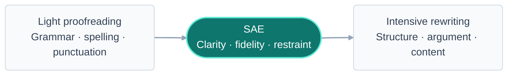

<div align="center">


<br>

**Evidence-calibrated English editing for SCI manuscripts.**<br>
Improve the prose without changing what the science is allowed to claim.

[](skills/sae/SKILL.md)
[](https://github.com/Nathanielneil/sae/actions/workflows/validate.yml)
[](LICENSE)
[](scripts/validate_skill.py)

[中文](README.zh-CN.md) · [Install](#install) · [Example](#see-the-difference) · [Editing policy](skills/sae/SKILL.md)

</div>

---

## Scientific editing needs a different kind of restraint

Generic AI polishing often makes a manuscript sound smoother at the cost of scientific precision. It stacks hedges, invents contrasts, adds promotional claims, and sometimes turns *association* into *causation*.

SAE is a reusable **Codex skill** built for the middle ground between proofreading and substantive rewriting. It edits grammar, clarity, concision, cohesion, and local paragraph flow while treating the manuscript's evidence as an invariant.

<table>
<tr>
<td width="33%" valign="top">

### Precise

Corrects grammar, syntax, idiom, terminology, tense, voice, and paragraph-level flow.

</td>
<td width="33%" valign="top">

### Restrained

Removes empty signposting, stacked hedges, false contrasts, and defensive AI-like prose.

</td>
<td width="33%" valign="top">

### Evidence-safe

Preserves data, statistics, citations, technical details, uncertainty, and scope of inference.

</td>
</tr>
</table>

## See the difference

> **Before**
>
> It should be emphasized that the proposed method may potentially improve the prediction accuracy to a certain extent. Of course, this does not necessarily mean that it can completely replace conventional methods. In the test cohort, the proposed method achieved an accuracy of 87.4%, whereas the baseline model achieved an accuracy of 81.2%.

> **After SAE**
>
> In the test cohort, the proposed method achieved an accuracy of 87.4%, compared with 81.2% for the baseline model. This result indicates improved predictive accuracy under the tested conditions.

The edit removes defensive framing and redundant uncertainty, keeps both numerical values, and retains the experimental boundary. See the [annotated example](examples/abstract.md).

## What SAE changes—and what it protects

| SAE improves | SAE preserves |
|---|---|
| Grammar, syntax, punctuation, articles, and idiom | Scientific meaning, research questions, and conclusions |
| Clarity, concision, sentence structure, and local paragraph flow | Numbers, units, sample sizes, conditions, and statistical values |
| Terminology, abbreviations, tense, voice, and English variant | Citations, equations, symbols, labels, and technical nomenclature |
| Redundancy, empty metadiscourse, promotional wording, and false contrasts | Association versus causation and observation versus interpretation |
| Unnecessary or stacked hedges | Necessary uncertainty, scope limits, and evidence-based qualifications |

When a sentence has more than one scientifically plausible meaning, SAE does not guess. It uses the safest faithful wording and raises an **author query**.

## Install

### Clone and install

```bash
git clone https://github.com/Nathanielneil/sae.git
cd sae
./scripts/install.sh
```

This installs SAE to `${CODEX_HOME:-$HOME/.codex}/skills/sae`. An existing installation is never overwritten silently. To replace it deliberately:

```bash
./scripts/install.sh --force
```

<details>
<summary><strong>Manual installation</strong></summary>

```bash
mkdir -p "${CODEX_HOME:-$HOME/.codex}/skills"
cp -R skills/sae "${CODEX_HOME:-$HOME/.codex}/skills/sae"
```

</details>

Start a new Codex session if the skill does not appear immediately.

## Use

Call the skill explicitly with `$sae`:

```text
Use $sae to edit the following Discussion section for submission to an SCI
journal. Preserve the scientific meaning and return only the edited text.

[Paste manuscript text here]
```

Give SAE whatever context is available; none of these fields is mandatory:

```text
Use $sae to edit this Abstract for Nature Communications.
- Field: biomedical engineering
- English: American
- Preserve every numerical value
- Return the edited text, then any necessary author queries

[Paste abstract here]
```

Chinese instructions work too:

```text
使用 $sae 对以下 Results 部分进行标准学术英文润色。保留所有数据、统计值、
单位和引文，只输出润色后的正文。
```

## Where SAE sits



SAE supports titles, abstracts, manuscript sections, full papers, figure captions, cover letters, and responses to reviewers. It does **not** replace peer review, fact-checking, translation, statistical review, or substantive scientific rewriting.

## Editing logic

SAE follows six rules:

1. **Scientific fidelity first** — never improve style by strengthening the claim.
2. **Main point before defense** — state the finding before unnecessary disclaimers.
3. **One sufficient hedge** — keep evidence-based caution; remove stacked qualifiers.
4. **No invented depth** — use contrast only where a real logical contrast exists.
5. **No silent guessing** — turn consequential ambiguity into an author query.
6. **No stylistic churn** — leave clear, correct sentences alone.

The full operational specification is available in [`skills/sae/SKILL.md`](skills/sae/SKILL.md).

## Repository

```text
.
├── skills/sae/              # Installable Codex skill
│   ├── SKILL.md             # Editing workflow and guardrails
│   └── agents/openai.yaml   # Skill interface metadata
├── examples/                # Before-and-after examples
├── scripts/                 # Installer and validator
└── .github/workflows/       # Continuous validation
```

Validate locally with no third-party dependencies:

```bash
python3 scripts/validate_skill.py
```

## Contributing

Issues and pull requests are welcome, especially for changes that improve scientific fidelity, editorial consistency, trigger accuracy, or discipline coverage. Keep project documentation outside the installable `skills/sae/` directory and run the validator before submitting a change.

## License

[MIT](LICENSE) © 2026 SAE contributors
