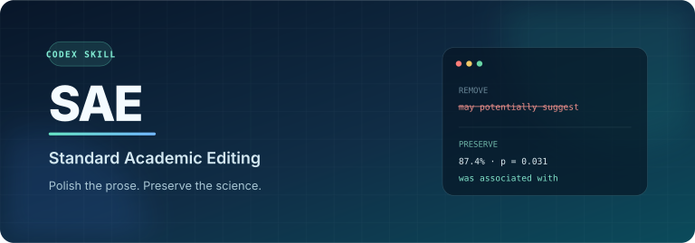
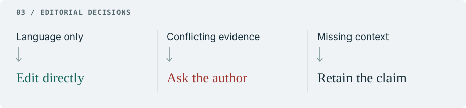

<picture>
  <source media="(max-width: 600px)" srcset="assets/hero-mobile.svg">
  
</picture>

Edit scientific English with `$sae` in Codex. Refine a sentence while keeping its evidence, citations, and degree of certainty intact.

[中文](README.zh-CN.md) · [Quick start](#quick-start) · [Editing rules](skills/sae/SKILL.md)

### In the margins

Two phrases in this abstract sound cautious. Only one limits what the study can claim.

<picture>
  <source media="(max-width: 600px)" srcset="assets/proof-mobile.svg">
  
</picture>

“Of course” can go. “Do not establish” must stay: the study has not shown that the method can fully replace conventional methods.

### Keeping the evidence in place

<picture>
  <source media="(max-width: 600px)" srcset="assets/values-en-mobile.svg">
  
</picture>

Both numbers come from the same illustrative passage. Each must stay with its model, just as a citation must stay with the finding it supports. [Read the annotated edit](examples/abstract.md).

### When the wording touches the science

<picture>
  <source media="(max-width: 600px)" srcset="assets/decisions-en-mobile.svg">
  
</picture>

An excerpt may omit the evidence for a claim. SAE preserves that claim. When supplied evidence conflicts with it, SAE retains the wording and asks the author before changing its meaning.

Request **clean text only** to receive safe edits without comments. Unresolved ambiguity stays in the passage; SAE asks first only when missing information blocks the whole task.

### Quick start

```bash
git clone https://github.com/Nathanielneil/sae.git
cd sae
./scripts/install.sh
```

Paste a passage after a request such as:

> Use $sae to edit this Discussion section. Preserve the strength of the claims and list any necessary author queries after the edited text.

<details>
<summary>Installation details and updates</summary>

The skill is installed at `${CODEX_HOME:-$HOME/.codex}/skills/sae`. Start a new Codex session if it does not appear. To replace an existing installation, run `./scripts/install.sh --force`. For manual installation, copy `skills/sae/` into the Codex skills directory after checking that the destination does not already exist.

</details>

[Behavioral cases & validation](tests/README.md) · [MIT license](LICENSE)
