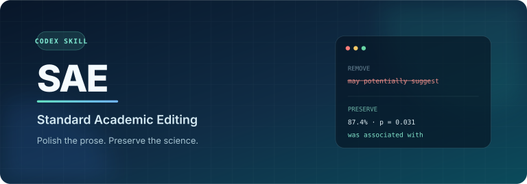

<picture>
  <source media="(max-width: 600px)" srcset="assets/hero-mobile.svg">
  
</picture>

在 Codex 中用 `$sae` 润色英文论文。让句子读起来更自然，也让每个数值、每处引文和每项结论都保留原意。

[English](README.md) · [快速上手](#快速上手) · [编辑规范](skills/sae/SKILL.md)

### 一处删改

下面这句摘要里，有两处措辞都显得谨慎，但只有一处真正限定了结论。

<picture>
  <source media="(max-width: 600px)" srcset="assets/proof-mobile.svg">
  
</picture>

删去 *Of course*，意思不变；保留 *do not establish*，读者才知道：这些结果尚不能证明新方法可以完全替代传统方法。

### 数值与归属

<picture>
  <source media="(max-width: 600px)" srcset="assets/values-zh-mobile.svg">
  
</picture>

两个数值出自同一段示例。即使调换语序，87.4% 仍属于所提方法，81.2% 仍属于基线模型；引文也须跟随它所支持的发现。[阅读全文对照](examples/abstract.md)

### 何时交给作者

<picture>
  <source media="(max-width: 600px)" srcset="assets/decisions-zh-mobile.svg">
  
</picture>

摘要里没写出依据，不能据此删掉主张。若已提供的材料确实矛盾，SAE 会保留原意，在允许问询时请作者确认。

如果要求**只给正文**，SAE 会先改能确定的部分，把局部歧义留在原处。只有整个任务都依赖缺失信息时，才先请求澄清。

### 快速上手

```bash
git clone https://github.com/Nathanielneil/sae.git
cd sae
./scripts/install.sh
```

在下面的请求之后，粘贴英文原文即可：

> 使用 $sae 润色这段 Discussion。保留主张强度，先给出正文，再列出必要的作者问询。

<details>
<summary>安装位置与更新方式</summary>

默认安装位置是 `${CODEX_HOME:-$HOME/.codex}/skills/sae`。未识别时请开启新的 Codex 会话。更新已有安装请运行 `./scripts/install.sh --force`。如需手动安装，确认目标目录不存在后，将 `skills/sae/` 复制到 Codex 的 skills 目录。

</details>

[行为案例与验证方法](tests/README.md) · [MIT 许可证](LICENSE)
